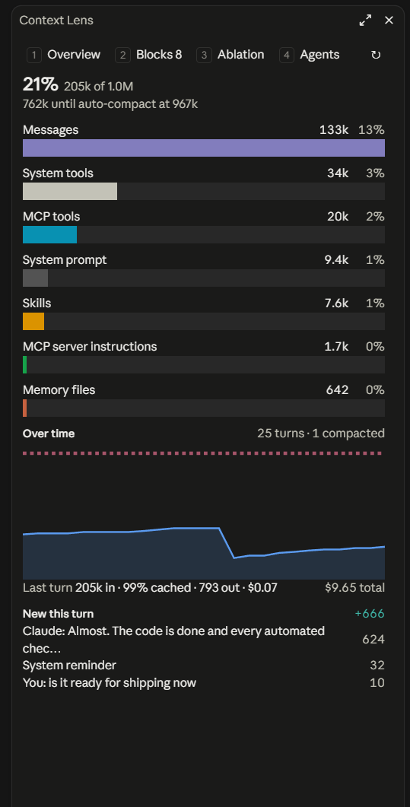
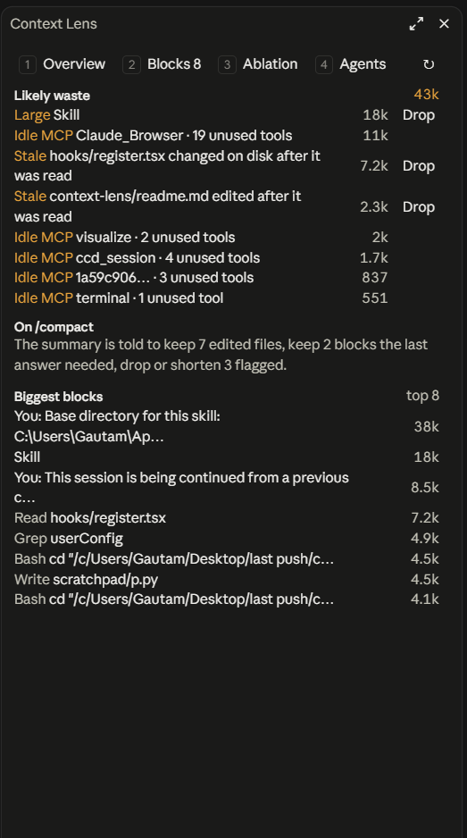

# Context Lens

A Claude Code mod that shows what's filling your context window and which parts of it your agent actually uses.

`/context` tells you how full the window is. I wanted to know what was in it, what the last turn added, and whether any of it was dead weight. Context Lens puts that in a side pane that updates after every turn.

<p>
  
  
</p>

## Install

At the prompt of a Claude Code terminal session:

```
/plugin install context-lens --marketplace Gautamstar/context-lens
```

Answer `y` to add the marketplace, then pick a scope. From a shell:

```bash
claude plugin install context-lens --marketplace Gautamstar/context-lens
```

In the desktop app, click + next to the prompt box, then Plugins, Add marketplace with `Gautamstar/context-lens`, then Add plugin.

You need Claude Code 2.1.299 or later. The plugin API it uses is early access, so a later update can still break things; Context Lens is built and tested against 2.1.299.

## What the pane shows

The pane has four tabs. Press 1 to 4 to switch, or ↻ to recount exactly.

The Overview tab shows how full the window is and how far you are from auto-compact, then a bar for each thing using it (system prompt, tools, memory files, messages), scaled so you can compare them at a glance. Under that is a chart of how full the window has been turn by turn, plus what the last turn cost: tokens sent, how much of that came from the prompt cache, tokens out, and dollars. A low cache percentage usually means something rewrote the start of the prompt, like editing CLAUDE.md or connecting an MCP server mid-session. Last comes what the latest turn added.

The Blocks tab lists the tokens that are probably wasted, then the biggest blocks in the conversation. Right now it flags four things: a file range that was read more than once, a read of a file that changed afterwards (so Claude is holding an old copy), any single tool output over 5k tokens (you can change the cutoff), and MCP tool schemas that get sent on every turn for tools the session never called.

The stale check doesn't only look for Claude's own edits. The mod records when each Read finishes and compares that with the file's modified time, so it also catches changes from a Bash command, a formatter or your editor. Reads from before the mod loaded have no recorded time, so only Claude's own edits can mark those stale.

The Ablation tab tests which blocks the last answer depended on (more on that below), and the Agents tab shows what each subagent cost and what it saved.

The status line keeps a short version, like `ctx 62% · waste 18k`.

All per-block token counts are estimates. They start at about four characters per token and are then scaled so they add up to Claude Code's own count of the messages, which keeps the lists consistent with the bars, but a single row can still be off by a fair amount.

## Dropping a block

Every waste row that points at something in the conversation has a Drop button. Drop replaces just that tool result with a one-line note saying it was removed, and leaves every other message exactly as it was. It works by queuing `/compact` and answering that compaction itself, so nothing gets summarized (you'll see the `/compact` line in the transcript). If something goes wrong, Drop cancels instead of falling back to a normal compaction.

Two things to know before you use it. The prompt cache starts over afterwards, so the next turn costs more than usual; dropping a 2k block to save 2k tokens a turn rarely pays for that. And for a file read more than once, Drop removes the older copies and keeps the newest one.

## Smarter compaction

When a normal compaction runs (your own `/compact`, or auto-compact), Context Lens adds a few notes to what the summarizer is told. It lists the files edited this session so the summary keeps their paths and what changed, the blocks the latest ablation found the answer needed so their facts survive, and the stale or repeated reads and long tool outputs so they get dropped or cut to one line. Your own `/compact` text still comes first. The Blocks tab shows what the next compaction will be told. Turn it off with the `compactionHints` setting.

Where an organization manages Claude Code, compaction hooks only run for plugins the organization lists in its managed settings. There, Drop and these notes do nothing, and the rest of the pane works as usual.

## Subagents

When Claude hands work to a subagent, the Agents tab shows what that trade looked like. For each Agent call you see how large the agent's own conversation grew (the reading and searching it did), how big the report it handed back was, which model ran it, how many tokens it processed and how long it took. The header adds up how much context delegation kept out of the main conversation.

That's the tradeoff in two numbers: an Explore agent that worked through 80k tokens and returned 1k kept 79k out of your main window, and you paid for those 80k on a cheaper model. An agent that returns almost as much as it read wasn't worth spawning.

## Testing which blocks mattered

`/ctx ablate` (or the Test blocks button) answers a different question: of the big blocks in context, which ones did the last answer actually depend on?

It takes your last question and the conversation before it, and replays it to a small model once as is and once with each of the biggest blocks removed. A second model call compares each answer to the baseline. If removing a block changes the answer, that block was needed. If nothing changes, it was along for the ride.

These calls cost real tokens, so nothing runs until you say so. The pane first shows how many replays it will make, how big each one is and the most that could cost at list price (it assumes nothing comes from the prompt cache, so the real bill is usually lower), with Run and Cancel buttons (or `/ctx ablate run` and `/ctx ablate cancel`). A conversation over 80k tokens is too big to replay; compact first.

A few details that keep the results honest and the cost low:

- The baseline runs twice. If the two runs disagree, the answer is noisy on its own, and the pane warns you not to read much into the results.
- The removed block is left out entirely, so the model gets no hint that something is missing.
- Each replay sends the same text up to the block it removes, so the requests put prompt-cache marks there to get some of it read from cache. How much varies a lot, so the pane shows what each run actually cost.

It has limits worth knowing. A small model reading a flattened transcript is a stand-in for the real model with its tools and system prompt, so treat a verdict as a hint about your session, not a measurement of it. Each variant is a single sample. And if two blocks carry the same information, removing either one alone changes nothing, so both show as unused. Testing blocks in pairs would catch that, and it's next on my list.

## What I found using it

The first real data came from the session I built it in. At about 205k tokens in context, the Blocks tab flagged 43k as likely waste. Less of that was stale file reads than I expected (around 10k). Most of it was a skill's 18k-token instructions that stayed in context long after they were needed, and 16k of schemas for MCP tools the session never called once.

The cache numbers were the other surprise. The last turn there was 99% cached, so a big context cost less per turn than I'd assumed, and the real cost of Drop is the one turn after it, when the cache rebuilds.

The first ablation run sent 1.3M input tokens to replay a long conversation, and only about a fifth of that came from cache. That's why runs now show a cost estimate and wait for you to press Run, and why conversations over 80k tokens are refused.

## Settings

Change these in `/config`, or under `pluginConfigs` in your settings file.

| Setting | Default | What it does |
| --- | --- | --- |
| `autoOpen` | `in-app` | When the pane opens by itself. `in-app` opens it in the desktop app and VS Code, and in a terminal leaves it to `/ctx`. `always` and `never` do what they say. |
| `ablationModel` | `haiku` | The model the ablation replays run on. `sonnet` is closer to what your session runs, and about twenty times the price. |
| `largeOutputTokens` | `5000` | How big a tool output has to be before it's flagged as waste. |
| `compactionHints` | on | Whether compactions get the notes described above. |

## Commands

| Command | What it does |
| --- | --- |
| `/ctx` | Open the pane and refresh it with local estimates |
| `/ctx full` | Refresh with exact counts from the token-counting API |
| `/ctx ablate [n]` | Work out the cost of testing the `n` biggest blocks (default 5, max 8) |
| `/ctx ablate run` | Start the test that's waiting |
| `/ctx ablate cancel` | Throw it away |

## How it's built

It's a single hooks module with no dependencies.

- `hooks/analyze.ts` turns the conversation into blocks, diffs turns, finds waste and works out what Drop rewrites. It's pure, so it's easy to test.
- `hooks/ablation.ts` builds the replay prompts and cache marks and estimates what a run costs. Also pure.
- `hooks/hints.ts` writes the notes a compaction gets. Also pure.
- `hooks/pane.tsx` draws the pane.
- `hooks/register.tsx` wires it to Claude Code. It refreshes on `session.measure`, times each Read on `tool.call`, prices turns and subagent runs on `turn.complete`, answers Drop's compaction and adds notes to the others on `session.compact`, runs the ablation's model calls and renders the pane.

To work on it, clone the repo and start a session with the folder loaded:

```bash
claude --plugin-dir ./context-lens
```

Run the tests and checks with:

```bash
claude plugin test ./context-lens
```

```bash
claude plugin validate ./context-lens
```

## License

MIT. Copyright (c) 2026 Gautam Singh.
